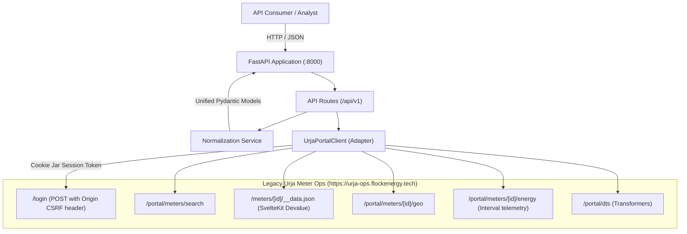

# Flock Energy — Urja Meter Ops API Wrapper

[](https://fastapi.tiangolo.com)
[](https://www.python.org/)
[]()
[]()

A production-quality asynchronous REST API wrapper providing programmatic, normalized access to smart meter telemetry, nameplate metadata, and distribution topology from the legacy SvelteKit-based **Urja Meter Ops** portal.

---

## Table of Contents
1. [Overview & Architecture](#overview--architecture)
2. [Project Structure](#project-structure)
3. [Prerequisites & Quickstart](#prerequisites--quickstart)
4. [Environment Configuration](#environment-configuration)
5. [Running the Application](#running-the-application)
6. [API Endpoints & curl Examples](#api-endpoints--curl-examples)
7. [Running Automated Tests](#running-automated-tests)
8. [Session & Authentication Design](#session--authentication-design)
9. [Error Handling & Security](#error-handling--security)
10. [Assumptions & Trade-offs](#assumptions--trade-offs)
11. [Known Limitations](#known-limitations)
12. [Live Integration Verification Status](#live-integration-verification-status)
13. [Key Deliverable Links](#key-deliverable-links)

---

## Overview & Architecture

Legacy operational systems frequently intermix server-side rendering, session cookies, internal devalue object serialization, and disparate REST endpoints. This service implements an **Anti-Corruption Layer (ACL)** that shields downstream energy applications and analytics systems from legacy portal quirks.



---

## Project Structure

```text
FLOCK/
├── app/
│   ├── __init__.py           # Application package
│   ├── main.py               # FastAPI application, exception handlers, lifecycle
│   ├── config.py             # pydantic-settings configuration
│   ├── client.py             # UrjaPortalClient HTTP adapter & session manager
│   ├── models.py             # Pydantic schemas (Request/Response models)
│   ├── exceptions.py         # Domain-specific adapter exceptions
│   ├── dependencies.py       # FastAPI dependency injection providers
│   ├── routes/
│   │   ├── __init__.py
│   │   ├── auth.py           # Session verification & authentication
│   │   ├── meters.py         # Meters list, detail, and consumption
│   │   └── hierarchy.py      # Grid distribution hierarchy
│   └── services/
│       ├── __init__.py
│       └── meter_service.py  # Deval decoding, HTML parsing, normalization
├── tests/
│   ├── __init__.py
│   ├── conftest.py           # Shared test fixtures & respx mock router
│   ├── test_health.py        # Health & OpenAPI schema tests
│   ├── test_auth.py          # Login, session recovery, cookie persistence
│   ├── test_meters.py        # Meter list, details (legacy & v2), HTML fallback
│   ├── test_consumption.py   # Energy intervals, date filters, parsing
│   ├── test_hierarchy.py     # Grid topology tree reconstruction
│   ├── test_reliability.py   # Timeouts, rate limits, 5xx, secret redaction
│   └── fixtures/
│       ├── __init__.py
│       └── portal_responses.py # Deterministic upstream response fixtures
├── docs/
│   └── architecture.md       # Comprehensive architectural documentation
├── export_openapi.py         # Script to export committed openapi.json
├── openapi.json              # Committed OpenAPI 3.1 specification
├── PROTOCOL.md               # Evidence-based protocol discovery report
├── REFLECTION.md             # Engineering reflection answering all 5 questions
├── requirements.txt          # Pinned dependency requirements
├── pytest.ini                # Pytest configuration
├── .env.example              # Environment variable template
└── .gitignore                # Git ignore rules (secrets, venv, caches)
```

---

## Prerequisites & Quickstart

- **Python**: Version 3.10 or newer (tested on Python 3.12).
- **Git**

### Installation

1. Clone or navigate to the repository directory:
   ```bash
   cd flock
   ```

2. Create and activate a Python virtual environment:
   - **Windows (PowerShell)**:
     ```powershell
     py -3.12 -m venv .venv
     .\.venv\Scripts\Activate.ps1
     ```
   - **macOS / Linux**:
     ```bash
     python3 -m venv .venv
     source .venv/bin/activate
     ```

3. Install project dependencies:
   ```bash
   pip install -r requirements.txt
   ```

---

## Environment Configuration

Copy `.env.example` to `.env`:
```bash
cp .env.example .env
```

Edit `.env` to configure your settings:
```ini
APP_NAME="Urja Meter Ops API"
APP_VERSION="1.0.0"
APP_ENV="development"
LOG_LEVEL="INFO"
API_PREFIX="/api/v1"

# Legacy Portal Configuration
URJA_BASE_URL="https://urja-ops.flockenergy.tech"
URJA_USERNAME="operator@urja.local"
URJA_PASSWORD="urja-ops-2026"

# Upstream Timeout & Retry Controls
UPSTREAM_TIMEOUT_SECONDS=15.0
UPSTREAM_MAX_RETRIES=1

# Local Fixture Mode (set to true to test completely offline)
MOCK_MODE=false
```

> **Security Note**: Real portal passwords and tokens are never committed to Git. `.env` is ignored by `.gitignore`.

---

## Running the Application

Start the development server with Uvicorn:
```bash
uvicorn app.main:app --reload --host 127.0.0.1 --port 8000
```

Once running:
- **Health Check**: [http://127.0.0.1:8000/health](http://127.0.0.1:8000/health)
- **Interactive Swagger UI**: [http://127.0.0.1:8000/docs](http://127.0.0.1:8000/docs)
- **ReDoc Documentation**: [http://127.0.0.1:8000/redoc](http://127.0.0.1:8000/redoc)
- **OpenAPI Schema**: [http://127.0.0.1:8000/openapi.json](http://127.0.0.1:8000/openapi.json)

---

## API Endpoints & curl Examples

### 1. Health Check
```bash
curl -s http://127.0.0.1:8000/health
```
*(Observed live response)*:
```json
{
  "status": "healthy",
  "app_name": "Urja Meter Ops API",
  "version": "1.0.0",
  "environment": "development",
  "upstream": {
    "reachable": true,
    "status_code": 200,
    "authenticated": true,
    "base_url": "https://urja-ops.flockenergy.tech"
  }
}
```

### 2. List Meters (Paginated & Searchable)
```bash
curl -s "http://127.0.0.1:8000/api/v1/meters?limit=2&offset=0"
```
*(Observed live response)*:
```json
{
  "data": [
    {
      "id": "J100000",
      "serial_number": "SE33962",
      "make": "HPL",
      "phase_type": "single",
      "status": "Decommissioned",
      "distribution_transformer_code": "DT-001"
    },
    {
      "id": "J100001",
      "serial_number": "GE84132",
      "make": "L&T",
      "phase_type": "single",
      "status": "Installed",
      "distribution_transformer_code": "DT-002"
    }
  ],
  "pagination": {
    "limit": 2,
    "offset": 0,
    "total": 403,
    "has_more": true
  }
}
```

### 3. Get Meter Details
```bash
curl -s http://127.0.0.1:8000/api/v1/meters/J100000
```
*(Observed live response)*:
```json
{
  "id": "J100000",
  "serial_number": "SE33962",
  "make": "HPL",
  "phase_type": "single",
  "status": "Decommissioned",
  "installation_type": "Whole Current",
  "build_type": "legacy",
  "distribution_transformer_code": "DT-001",
  "location": {
    "latitude": 26.938961002479868,
    "longitude": 75.83095696146852
  },
  "hierarchy": {
    "zone": "Jaipur Zone 1 (Z-01)",
    "circle": "Circle 1 (C-01)",
    "division": "Division 1 (D-01)",
    "subdivision": "Subdivision 1 (SD-01)",
    "substation": "Substation 1 (SS-01)",
    "feeder": "Feeder 1 (F-001)",
    "distribution_transformer": "Malviya Nagar DT 1 (DT-001)"
  },
  "attributes": {
    "Meter ID": "J100000",
    "Serial No": "SE33962",
    "Make": "HPL",
    "Phase Type": "single",
    "Installation Status": "Decommissioned",
    "Installation Type": "Whole Current"
  }
}
```

### 4. Get Consumption History (with Date Filters)
```bash
curl -s "http://127.0.0.1:8000/api/v1/meters/J100000/consumption?from=2026-06-25&to=2026-06-26"
```
*(Observed live response snippet)*:
```json
{
  "meter_id": "J100000",
  "reading_count": 96,
  "unit_kwh": "kWh (cumulative)",
  "unit_kvah": "kVAh (cumulative)",
  "unit_voltage": "V (R-phase)",
  "readings": [
    {
      "timestamp": "2026-06-25T00:00:00",
      "raw_timestamp": "25/06/2026 00:00",
      "kwh": 48459.45,
      "kvah": 52336.56,
      "voltage_r": 226.0
    },
    {
      "timestamp": "2026-06-25T00:30:00",
      "raw_timestamp": "25/06/2026 00:30",
      "kwh": 48459.88,
      "kvah": 52337.02,
      "voltage_r": 228.0
    }
  ]
}
```

### 5. Get Grid Distribution Hierarchy
```bash
curl -s http://127.0.0.1:8000/api/v1/hierarchy
```
*(Observed live response snippet)*:
```json
{
  "is_partial": false,
  "summary": "Distribution Transformer topology mapped to Feeders",
  "total_distribution_transformers": 40,
  "nodes": [
    {
      "id": "F-001",
      "name": "Feeder F-001",
      "type": "feeder",
      "parent_id": null,
      "children": [
        {
          "id": "DT-001",
          "name": "Malviya Nagar DT 1",
          "type": "distribution_transformer",
          "parent_id": "F-001",
          "children": [],
          "metadata": {
            "capacity_kva": 100
          }
        }
      ],
      "metadata": {
        "dt_count": 2
      }
    }
  ]
}
```

---

## Running Automated Tests

The test suite runs deterministically offline using `respx` mock HTTP transport and controlled fixtures without requiring live portal connectivity or production credentials.

Run all tests:
```bash
pytest -v
```

Output:
```text
tests/test_auth.py::test_successful_login PASSED
tests/test_auth.py::test_invalid_credentials PASSED
tests/test_expired_session_reauthenticates_automatically PASSED
tests/test_auth.py::test_concurrent_requests_on_expired_session_single_login PASSED
tests/test_auth.py::test_prevent_infinite_retry_loop_on_persistent_auth_failure PASSED
tests/test_auth.py::test_auth_login_api_endpoint PASSED
tests/test_auth.py::test_auth_login_custom_credentials_forbidden_in_production PASSED
tests/test_auth.py::test_api_key_enforcement PASSED
tests/test_consumption.py::test_get_consumption PASSED
tests/test_consumption.py::test_consumption_date_filtering PASSED
tests/test_consumption.py::test_consumption_invalid_date_order PASSED
tests/test_consumption.py::test_consumption_normalization_robustness PASSED
tests/test_health.py::test_health_endpoint PASSED
tests/test_health.py::test_openapi_schema PASSED
tests/test_health.py::test_swagger_ui_available PASSED
tests/test_hierarchy.py::test_get_hierarchy PASSED
tests/test_hierarchy.py::test_build_hierarchy_tree_edge_cases PASSED
tests/test_hierarchy.py::test_build_hierarchy_deduplicates_and_handles_empty PASSED
tests/test_meters.py::test_list_meters PASSED
tests/test_meters.py::test_pagination_exact_slice_limit_2_offset_1 PASSED
tests/test_meters.py::test_pagination_across_page_boundary PASSED
tests/test_meters.py::test_pagination_empty_results PASSED
tests/test_meters.py::test_pagination_offset_past_total PASSED
tests/test_meters.py::test_pagination_final_page PASSED
tests/test_meters.py::test_get_meter_legacy_build PASSED
tests/test_meters.py::test_get_meter_v2_classdata_build PASSED
tests/test_meters.py::test_get_meter_not_found PASSED
tests/test_meters.py::test_get_meter_invalid_id_format PASSED
tests/test_meters.py::test_get_meter_does_not_swallow_upstream_error PASSED
tests/test_meters.py::test_html_parsing_fallback PASSED
tests/test_reliability.py::test_upstream_timeout PASSED
tests/test_reliability.py::test_upstream_rate_limiting PASSED
tests/test_reliability.py::test_upstream_500_error PASSED
tests/test_reliability.py::test_read_only_enforcement PASSED
tests/test_reliability.py::test_secret_redaction_in_error_responses PASSED
tests/test_reliability.py::test_cors_wildcard_credentials_prohibited PASSED

============================= 36 passed in 9.26s ==============================
```

---

## Session & Authentication Design

1. **CSRF Enforcement**: SvelteKit strictly validates the `Origin` header for form submissions. The adapter sets `Origin: https://urja-ops.flockenergy.tech` to ensure compliant handshakes.
2. **Session Cookie Persistence**: Outbound requests carry `__Secure-better-auth.session_token` inside the client cookie jar.
3. **Concurrent Session Recovery & Versioning**: If the upstream session expires (HTTP 401, login page redirect, or SvelteKit redirect payload), the adapter intercepts the response. Under an asynchronous lock, the client inspects a monotonic session version: if another coroutine already refreshed the session, subsequent concurrent requests immediately retry using the refreshed token without issuing redundant logins.
4. **Loop Protection**: Automatic retry is strictly limited to 1 attempt to prevent infinite authentication loops.

---

## Error Handling & Security

- **Exact Slice Pagination**: The upstream portal only serves fixed 20-item pages (`page=1, 2, ...`). The wrapper dynamically fetches across page boundaries, accumulates items into a buffer, slices exactly `[offset : offset + limit]`, and returns accurate pagination metadata (`total`, `limit`, `offset`, `has_more`). Bounded fetching prevents runaway loops.
- **API Key Protection**: Configurable API key protection via `X-API-Key` header (`API_KEY` in environment). When unconfigured, it permits convenient zero-config local development; when set in staging or production, all `/api/v1` routes require valid authorization.
- **CORS Hardening**: Strict validation ensures `allow_credentials=True` is never combined with wildcard origins (`["*"]`). Specific origins must be declared when cookie/credential forwarding is enabled.
- **Login Endpoint Safeguards**: The public `/api/v1/auth/login` endpoint rejects caller-supplied credentials in production (`APP_ENV != development`) to prevent credential stuffing or unauthorized proxy authentication.
- **Read-Only Enforcement**: Outbound portal interactions are restricted to read-only `GET` requests; any attempt to trigger state-altering methods throws `PortalUpstreamError`.
- **Meter Identifier Sanitization**: Meter IDs are strictly validated with `^[A-Za-z0-9_\-\.]{1,64}$` before path interpolation, blocking path traversal or injection.
- **Status Code Mapping**:
  - `200`: Successful data retrieval.
  - `400`: Parameter validation errors (e.g. invalid date ranges or empty identifiers).
  - `401`: Missing or invalid `X-API-Key`.
  - `403`: Forbidden operations (such as custom credentials in production).
  - `404`: Meter or resource not found (strictly preserved, never masked by fallback errors).
  - `429`: Upstream rate limit with `Retry-After` header passthrough.
  - `502`: Bad Gateway / Upstream communication or parse error.
  - `504`: Gateway Timeout on upstream response delays.
- **Secret Redaction**: Session tokens, passwords, and upstream HTML dumps are redacted from client error messages and application logs.
- **Consistent Envelope**: All errors follow the uniform envelope:
  ```json
  {
    "error": {
      "code": "NOT_FOUND",
      "message": "The requested meter or resource was not found.",
      "request_id": "8f3b2a1c"
    }
  }
  ```

---

## Assumptions & Trade-offs

1. **Cumulative vs. Interval Energy**: We observed that energy readings (`kwh`, `kvah`) steadily increase across successive 30-minute intervals. Consequently, the API treats them as cumulative meter register readings and documents the unit explicitly (`kWh (cumulative)`).
2. **Dual-Format Meter Details**: Live reconnaissance proved that meters with `build: "legacy"` use array parameters while `build: "v2"` use JSON-encoded strings in `classData`. The normalization service handles both transparently.
3. **Direct Hierarchy Discovery**: Transformers (`/portal/dts`) contain `feederCode`. Rather than querying non-existent feeder endpoints, we reconstruct the topology tree dynamically.

---

## Known Limitations

- **Sequential DT Paging**: `/portal/dts` has 40 transformers across 2 pages. For very large grids with thousands of transformers, sequential synchronous paging would introduce latency; a background caching task would be appropriate in a larger enterprise system.
- **Read-Only Scope**: In adherence to the take-home instructions, all interactions with the legacy portal are strictly read-only.

---

## Live Integration Verification Status

- [x] Portal Authentication (`operator@urja.local`) verified live.
- [x] Session cookie persistence verified live.
- [x] Meter search & collection (`403 total meters`) verified live.
- [x] Meter detail decoding (legacy & v2 format) verified live.
- [x] Meter geo coordinates verified live.
- [x] Consumption history & date filtering (`from`/`to`) verified live.
- [x] Hierarchy reconstruction (Feeders & Transformers) verified live.
- [x] Error handling & 404 responses verified live.

---

## Key Deliverable Links

- [PROTOCOL.md](file:///PROTOCOL.md): Evidence-based discovery report.
- [REFLECTION.md](file:///REFLECTION.md): Reflection answers to the five assignment questions.
- [architecture.md](file:///docs/architecture.md): Architectural design document.
- [openapi.json](file:///openapi.json): Committed OpenAPI 3.1 specification.
