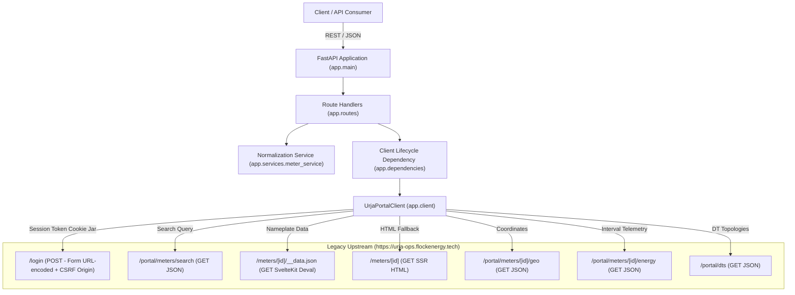

# Urja Meter Ops API — Architecture & System Design

## 1. Architectural Overview

The **Flock Energy Urja Meter Ops API** is a production-grade REST API wrapper around the legacy SvelteKit-based Urja Meter Ops operational portal (`https://urja-ops.flockenergy.tech`).

Legacy metering systems typically combine server-side rendering, session cookies, non-standard devalue serialization, and scattered REST endpoints. This wrapper acts as an **Anti-Corruption Layer (ACL)**, isolating downstream consumer applications from legacy session mechanics, CSRF quirks, schema irregularities, and UI routing protocols.



---

## 2. Component Design & Responsibilities

### `app/config.py` (Configuration Layer)
- Manages application configuration via `pydantic-settings`.
- Loads from environment variables and `.env` files with validation.
- Isolates sensitive credentials (`URJA_USERNAME`, `URJA_PASSWORD`) and connection timeouts (`UPSTREAM_TIMEOUT_SECONDS`).

### `app/client.py` (Upstream Adapter Layer)
- Manages an asynchronous connection pool via `httpx.AsyncClient`.
- Implements the complete authorized login handshake with CSRF header enforcement (`Origin: https://urja-ops.flockenergy.tech`).
- Maintains the persistent session cookie (`__Secure-better-auth.session_token`).
- Implements transparent session recovery: detects session expiry (`HTTP 401`, login redirects, or SvelteKit redirect payloads), re-authenticates under an `asyncio.Lock`, and retries the read operation once.
- Maps upstream status codes and network faults to domain exceptions.

### `app/services/meter_service.py` (Normalization & Business Logic Layer)
- **SvelteKit Deval Decoder**: Recursively resolves graph-indexed arrays from `/meters/{id}/__data.json` to extract nameplate attributes and grid hierarchy.
- **Dual Schema Support**: Handles both legacy build format (`parameterName`/`parameterValue` lists) and v2 build format (`classData` JSON strings).
- **HTML Fallback Parser**: Parses server-rendered HTML using `BeautifulSoup4` if devalue endpoints are unavailable.
- **Consumption Normalizer**: Transforms source timestamps (`DD/MM/YYYY HH:MM`) to ISO 8601 strings and validates cumulative kWh, kVAh, and voltage measurements.
- **Hierarchy Reconstructor**: Reconstructs electrical grid topology by grouping Distribution Transformers (DTs) under their respective Feeder codes.

### `app/routes/` (Public API Layer)
- `auth.py`: Endpoint to trigger, verify, or re-establish upstream portal sessions.
- `meters.py`: Collection listing with pagination and search, meter details, and consumption interval history with date range filtering.
- `hierarchy.py`: Grid topology endpoint returning Feeder and Distribution Transformer graphs.

### `app/exceptions.py` & Global Exception Handlers
- Prevents raw stack traces, portal credentials, or session cookies from leaking to API consumers.
- Enforces consistent error envelopes:
  ```json
  {
    "error": {
      "code": "NOT_FOUND",
      "message": "The requested meter or resource was not found.",
      "request_id": "a1b2c3d4"
    }
  }
  ```

---

## 3. Session & Security Model

1. **Authentication Decoupling**: API consumers do not handle or receive raw upstream session cookies or credentials.
2. **CSRF Protection Compliance**: SvelteKit requires the `Origin` header matching the target base URL for POST requests; the adapter sets and manages this explicitly.
3. **Lock-Protected Re-Authentication**: When an upstream session expires, an asynchronous lock ensures only one re-authentication request is issued, avoiding thundering herd problems.
4. **Credential Isolation**: Credentials are provided via `.env` (excluded by `.gitignore`), redacting sensitive parameters from logs, error messages, and OpenAPI documentation.
